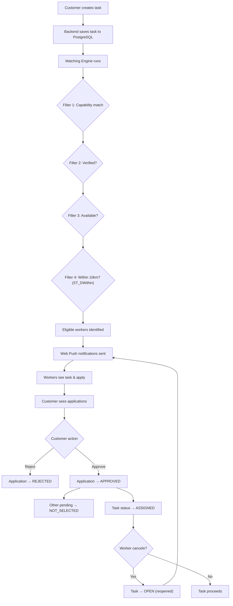

# 🥔 Potato Task Workflow — Implementation Plan (v2)

> **Scope:** Customer creates a task → Eligible workers are notified → Workers apply → Customer approves one → Others are notified → Worker can cancel → Customer can reopen.
>
> **No code changes yet.** This document is the blueprint.

---

## Overview: What We're Building



---

## Technologies Used

| Technology | Purpose |
|---|---|
| **PostgreSQL + PostGIS** | Task storage, `ST_DWithin()` for proximity matching |
| **Redis** | Ephemeral worker GPS locations (2h TTL) |
| **Web Push API** | Browser push notifications (even when app is closed) |
| **`pywebpush`** | Python library for sending VAPID-authenticated push messages |
| **Service Worker** | Frontend JS that receives and displays push notifications |
| **Alembic** | Database migrations for new tables |
| **GeoAlchemy2** | PostGIS integration with SQLAlchemy (already in use) |

---

## Step 1: Database Schema — New Tables & Enums

### 1a. New Enums

```python
# backend/app/features/tasks/enums.py

class TaskStatus(str, Enum):
    OPEN = "open"                   # Created, accepting applications
    ASSIGNED = "assigned"           # Customer approved a worker
    IN_PROGRESS = "in_progress"     # Worker started the job
    COMPLETED = "completed"         # Job done
    CANCELLED = "cancelled"         # Customer cancelled
    EXPIRED = "expired"             # scheduled_at has passed with no assignment

class ApplicationStatus(str, Enum):
    PENDING = "pending"             # Worker applied, waiting for customer
    APPROVED = "approved"           # Customer selected this worker
    REJECTED = "rejected"           # Customer explicitly rejected this worker
    NOT_SELECTED = "not_selected"   # Another worker was approved; this one was auto-dismissed
    WITHDRAWN = "withdrawn"         # Worker withdrew their own application
    CANCELLED = "cancelled"         # Worker cancelled AFTER being approved
```

> [!NOTE]
> **REJECTED vs NOT_SELECTED:** `REJECTED` means the customer explicitly clicked "Reject" on this application. `NOT_SELECTED` means the customer approved someone else and this worker was automatically dismissed. The distinction matters for worker UX — being "not selected" feels less personal than being "rejected".

### 1b. `tasks` Table

```python
# backend/app/features/tasks/models.py

class Task(Base):
    __tablename__ = "tasks"

    id              UUID PK default=uuid4
    customer_id     UUID FK → users.id ON DELETE CASCADE
    subcategory_id  UUID FK → subcategories.id ON DELETE RESTRICT

    description     Text, nullable=False
    scheduled_at    DateTime(timezone=True), nullable=False

    # Location (PostGIS POINT for ST_DWithin spatial queries)
    location        Geometry('POINT', srid=4326), nullable=False
    address         String(500), nullable=True   # human-readable, for display only

    budget          Numeric(10,2), nullable=False  # ₹ amount, REQUIRED
    specific_requirements  Text, nullable=True

    status          Enum(TaskStatus), default=OPEN

    # Set when customer approves a worker
    assigned_worker_id  UUID FK → users.id, nullable=True
    assigned_at         DateTime, nullable=True

    created_at      DateTime server_default=now()
    updated_at      DateTime server_default=now(), onupdate=now()

    # Relationships
    customer        → User
    subcategory     → Subcategory
    assigned_worker → User (nullable)
    applications    → list[TaskApplication]
```

### 1c. `task_applications` Table

```python
class TaskApplication(Base):
    __tablename__ = "task_applications"

    id              UUID PK default=uuid4
    task_id         UUID FK → tasks.id ON DELETE CASCADE
    worker_id       UUID FK → users.id ON DELETE CASCADE

    status          Enum(ApplicationStatus), default=PENDING

    # Worker can include a message/bid
    message         Text, nullable=True
    proposed_budget Numeric(10,2), nullable=True  # counter-offer

    created_at      DateTime server_default=now()
    updated_at      DateTime server_default=now(), onupdate=now()

    # Unique constraint: one application per worker per task
    __table_args__ = (UniqueConstraint('task_id', 'worker_id'),)

    # Relationships
    task   → Task
    worker → User
```

### 1d. `push_subscriptions` Table

```python
class PushSubscription(Base):
    __tablename__ = "push_subscriptions"

    id              UUID PK default=uuid4
    user_id         UUID FK → users.id ON DELETE CASCADE

    # The Web Push subscription object (from browser)
    endpoint        String, nullable=False, unique=True
    p256dh_key      String, nullable=False     # encryption key
    auth_key        String, nullable=False     # auth secret

    # Metadata
    user_agent      String, nullable=True      # browser/device info

    created_at      DateTime server_default=now()
```

> [!NOTE]
> A single user can have multiple push subscriptions (desktop browser + mobile browser). That's why this is a separate table, not a column on `users`.

### 1e. Alembic Migration

One migration file to create all three tables + enums:
- `alembic/versions/xxxx_add_tasks_applications_push.py`

---

## Step 2: Redis Architecture — Worker Live Location

### 2a. Redis Key Design

```
worker:location:{worker_id}  →  JSON {"lat": 19.076, "lng": 72.877, "ts": 1696200000}
TTL: 7200 seconds (2 hours)
```

### 2b. Location Update Endpoint

```
POST /workers/me/location
Body: { "latitude": 19.076, "longitude": 72.877 }
```

- Requires authenticated worker
- Stores in Redis with 2h TTL
- Called by frontend at regular intervals (see 2d)

### 2c. Location Retrieval Logic (used by Matching Engine)

```python
async def get_worker_location(redis, db, worker_id) -> tuple[float, float, str] | None:
    """
    Returns (lat, lng, source) or None.

    1. Check Redis for live GPS (< 2 hours old)
    2. If expired/missing, fall back to home_base from PostgreSQL
    3. If no home_base either, return None (worker cannot be matched)
    """
    data = await redis.get(f"worker:location:{worker_id}")
    if data:
        loc = json.loads(data)
        return (loc["lat"], loc["lng"], "live")

    # Fallback: query home_base from worker_profiles
    result = await db.execute(
        select(
            func.ST_Y(WorkerProfile.home_base).label("lat"),
            func.ST_X(WorkerProfile.home_base).label("lng"),
        )
        .where(
            WorkerProfile.user_id == worker_id,
            WorkerProfile.home_base.isnot(None)
        )
    )
    row = result.first()
    if row and row.lat is not None:
        return (row.lat, row.lng, "home_base")

    return None
```

### 2d. Frontend — Interval-Based Location Polling

When the worker toggles **"Go Online"**, the frontend starts a location polling loop:

```typescript
// frontend/src/shared/lib/locationTracker.ts

let watchId: number | null = null;
let intervalId: ReturnType<typeof setInterval> | null = null;

export function startLocationTracking() {
    // Initial position
    sendLocation();

    // Poll every 5 minutes
    intervalId = setInterval(sendLocation, 5 * 60 * 1000);

    // Also watch for significant movement
    if (navigator.geolocation) {
        watchId = navigator.geolocation.watchPosition(
            (pos) => sendLocation(pos.coords.latitude, pos.coords.longitude),
            null,
            { enableHighAccuracy: false, maximumAge: 300_000 }
        );
    }
}

export function stopLocationTracking() {
    if (watchId !== null) navigator.geolocation.clearWatch(watchId);
    if (intervalId !== null) clearInterval(intervalId);
    watchId = null;
    intervalId = null;
}

async function sendLocation(lat?: number, lng?: number) {
    if (!lat || !lng) {
        // Get current position if not provided
        const pos = await new Promise<GeolocationPosition>((resolve, reject) =>
            navigator.geolocation.getCurrentPosition(resolve, reject)
        );
        lat = pos.coords.latitude;
        lng = pos.coords.longitude;
    }
    await api.post("/workers/me/location", { latitude: lat, longitude: lng });
}
```

> [!TIP]
> The dual approach ensures coverage: `setInterval` guarantees we ping every 5 minutes even if the worker is stationary, and `watchPosition` catches real-time movement. The Redis TTL of 2 hours means even if the worker closes the browser, their location remains valid for matching for another 2 hours. After that, the system falls back to `home_base`.

---

## Step 3: Keyword-Based Service Search

### 3a. Search Endpoint

```
GET /categories/search?q=biryani
```

This already has the foundation — subcategories have a `keywords` JSONB column. The search logic:

```python
async def search_subcategories(db, query: str) -> list[Subcategory]:
    """
    Search subcategories by name OR by any keyword match.
    Case-insensitive partial matching.
    """
    q = query.lower().strip()

    results = await db.execute(
        select(Subcategory)
        .join(Category)
        .where(
            Subcategory.is_active == True,
            Category.is_active == True,
            or_(
                func.lower(Subcategory.name).contains(q),
                # Search inside JSONB array: any keyword contains the query
                Subcategory.keywords.op('@>')(cast([q], JSONB))
            )
        )
    )
    return results.scalars().all()
```

> [!TIP]
> For the MVP, a simple `ILIKE` or `@>` operator on the JSONB array is sufficient. You can add PostgreSQL full-text search (`tsvector`) later when you need fuzzy matching (e.g., "biryni" → "biryani").

---

## Step 4: Task Creation

### 4a. Backend — Create Task Endpoint

```
POST /tasks
Auth: Any authenticated user (customer)
Body: {
    "subcategory_id": "uuid",
    "description": "Need chicken biryani for 6 people",
    "scheduled_at": "2026-10-05T19:00:00+05:30",
    "latitude": 19.076,
    "longitude": 72.877,
    "address": "123 Main St, Mumbai",
    "budget": 600.00,
    "specific_requirements": "Please bring your own ingredients"
}
```

**Validation:**
- `budget` is **required** (non-nullable). Frontend will not allow submission without it.
- `subcategory_id` must exist and be active.
- `scheduled_at` must be in the future.

**Logic:**
1. Validate `subcategory_id` exists and is active
2. Validate `scheduled_at` is in the future
3. Convert lat/lng to PostGIS `POINT(lng lat)`
4. Create `Task` with status = `OPEN`
5. **Trigger matching engine** (synchronous for MVP)
6. Return created task

### 4b. Frontend — Task Composer Page

New feature directory: `frontend/src/features/tasks/`

The customer's flow:
1. **Search bar** on dashboard: "What do you need help with?"
2. Type query → hits `GET /categories/search?q=...` → shows matching subcategories
3. Select a subcategory → opens task form
4. Fill in: description, date/time, location (with "Use current location" button), **budget (required)**, requirements
5. Submit → `POST /tasks`

### 4c. Files to Create

```
frontend/src/features/tasks/
├── pages/
│   └── CreateTaskPage.tsx          # The task composer wizard
├── components/
│   ├── ServiceSearch.tsx           # Keyword search + subcategory selector
│   ├── LocationPicker.tsx          # Map/GPS with "Use current location"
│   └── TaskForm.tsx                # Description, date, budget, requirements
└── schemas/
    └── taskSchemas.ts              # TypeScript types
```

---

## Step 5: The Matching Engine (using PostGIS `ST_DWithin`)

This is the core brain of Potato. When a task is created, this service finds eligible workers.

### 5a. Location: `backend/app/features/tasks/matching.py`

### 5b. The Filter Pipeline

We use PostGIS `ST_DWithin()` directly in SQL. This is more efficient than the Haversine approach because:
- The database handles the distance calculation in C, not Python
- PostGIS uses spatial indexes (GiST) for fast lookups
- We already have PostGIS set up and `home_base` is a `Geometry(POINT)` column

```python
from geoalchemy2.functions import ST_DWithin, ST_MakePoint, ST_SetSRID
from sqlalchemy import func, cast

SEARCH_RADIUS_METERS = 10_000  # 10 km

async def find_eligible_workers(
    db: AsyncSession,
    redis: Redis,
    task: Task
) -> list[dict]:
    """
    Returns a list of eligible workers with their distances.

    Filter pipeline (3 filters — subscription skipped for MVP):
    1. Capability  — worker has task.subcategory_id
    2. Verified    — verification_status = VERIFIED
    3. Available   — is_available = True
    4. Proximity   — within 10km of task location (ST_DWithin)
    """

    # ── Step 1-3: SQL query (capability + verified + available) ──
    stmt = (
        select(WorkerProfile.user_id)
        .join(WorkerCapability, WorkerProfile.user_id == WorkerCapability.worker_id)
        .where(
            WorkerCapability.subcategory_id == task.subcategory_id,
            WorkerProfile.verification_status == VerificationStatus.VERIFIED,
            WorkerProfile.is_available == True,
        )
    )
    result = await db.execute(stmt)
    candidate_ids = [row[0] for row in result.all()]

    if not candidate_ids:
        return []

    # ── Step 4: Proximity check ──
    # Strategy: check Redis first for live location, fall back to home_base
    eligible = []

    for worker_id in candidate_ids:
        location = await get_worker_location(redis, db, worker_id)
        if location is None:
            continue

        lat, lng, source = location

        # Use PostGIS to calculate distance
        worker_point = func.ST_SetSRID(func.ST_MakePoint(lng, lat), 4326)

        dist_result = await db.execute(
            select(
                func.ST_Distance(
                    cast(task.location, Geometry(srid=4326)).cast_to_geography(),
                    worker_point.cast_to_geography()
                ).label("distance_m")
            )
        )
        distance_m = dist_result.scalar()

        if distance_m is not None and distance_m <= SEARCH_RADIUS_METERS:
            eligible.append({
                "worker_id": worker_id,
                "distance_km": round(distance_m / 1000, 1),
                "location_source": source  # "live" or "home_base"
            })

    return eligible
```

> [!NOTE]
> **Why not a single SQL query with `ST_DWithin` on `home_base`?** Because some workers have a live GPS location in Redis that's different from their `home_base`. We need to check Redis first for each worker, and only fall back to `home_base` if Redis doesn't have them. This hybrid approach gives us the most accurate matching.
>
> **Future optimization:** When you have many workers, you can do the Redis-located workers and home_base-only workers as two separate batches — one Python distance check (for Redis workers) and one pure SQL `ST_DWithin` query (for home_base fallback workers).

---

## Step 6: Web Push Notifications

### 6a. Technology: VAPID + `pywebpush`

Web Push requires a VAPID key pair (one-time generation):

```bash
# Generate VAPID keys (run once, store in .env)
pip install pywebpush
python -c "
from py_vapid import Vapid
v = Vapid()
v.generate_keys()
print('Private:', v.private_pem())
print('Public:', v.public_key)
"
```

Add to `.env`:
```env
VAPID_PRIVATE_KEY=<base64 private key>
VAPID_PUBLIC_KEY=<base64 public key>
VAPID_CLAIM_EMAIL=mailto:your-actual-email@gmail.com
```

> [!NOTE]
> **About `VAPID_CLAIM_EMAIL`:** This should be a real email address you own (prefixed with `mailto:`). Push services (like Google's FCM or Mozilla's autopush) use this to contact you if there's an issue with your push messages (e.g., abuse reports). It's never shown to users. Your personal Gmail works fine for development.

Add to `config.py`:
```python
vapid_private_key: str
vapid_public_key: str
vapid_claim_email: str = "mailto:your-email@gmail.com"
```

### 6b. Frontend — Service Worker Registration

```
frontend/public/sw.js                    # Service Worker file
frontend/src/shared/lib/pushManager.ts   # Subscribe/unsubscribe logic
```

**Service Worker (`sw.js`):**
```javascript
self.addEventListener('push', (event) => {
    const data = event.data.json();
    self.registration.showNotification(data.title, {
        body: data.body,
        icon: '/potato-icon.png',
        data: { url: data.url }
    });
});

self.addEventListener('notificationclick', (event) => {
    event.notification.close();
    event.waitUntil(clients.openWindow(event.notification.data.url));
});
```

**Push Subscription Flow:**
1. When a worker goes **online** (toggles availability), the frontend calls `pushManager.subscribe()` with the VAPID public key
2. Browser returns a `PushSubscription` object containing `endpoint`, `keys.p256dh`, `keys.auth`
3. Frontend sends this to `POST /push/subscribe`
4. Backend stores it in `push_subscriptions` table

### 6c. Backend — Push Subscription Endpoints

```
POST /push/subscribe
Body: {
    "endpoint": "https://fcm.googleapis.com/fcm/send/...",
    "p256dh_key": "BNcRd...",
    "auth_key": "tBHI..."
}

DELETE /push/subscribe
Body: { "endpoint": "https://..." }
```

### 6d. Backend — Send Push Notification (generic helper)

```python
# backend/app/features/push/service.py

from pywebpush import webpush, WebPushException

async def send_push_to_user(db, user_id: uuid.UUID, payload: dict):
    """Send a push notification to all devices of a user."""

    subs = await db.execute(
        select(PushSubscription)
        .where(PushSubscription.user_id == user_id)
    )

    data = json.dumps(payload)

    for sub in subs.scalars():
        try:
            webpush(
                subscription_info={
                    "endpoint": sub.endpoint,
                    "keys": {
                        "p256dh": sub.p256dh_key,
                        "auth": sub.auth_key
                    }
                },
                data=data,
                vapid_private_key=settings.vapid_private_key,
                vapid_claims={"sub": settings.vapid_claim_email}
            )
        except WebPushException as e:
            if e.response and e.response.status_code in (404, 410):
                # Subscription expired/invalid, clean up
                await db.delete(sub)
                await db.commit()
```

---

## Step 7: Worker Sees & Applies for Task

### 7a. Task Detail Page (Worker View)

```
GET /tasks/{task_id}
```

Displays:
- Subcategory name
- Description
- Scheduled date/time
- Distance from worker
- Budget
- Specific requirements
- **[ Apply ]** button (if status = OPEN and worker hasn't applied yet)

### 7b. Worker Applies

```
POST /tasks/{task_id}/apply
Auth: Worker (verified + available)
Body: {
    "message": "I can cook excellent biryani, have 5 years experience",
    "proposed_budget": 550.00   // optional counter-offer
}
```

**Backend Logic:**
1. Verify task exists and status = `OPEN`
2. Verify `scheduled_at` hasn't passed (if it has, auto-expire the task)
3. Verify worker has the required capability (`subcategory_id`)
4. Verify worker is `VERIFIED` and `is_available`
5. Check no existing active application from this worker (unique constraint)
6. Create `TaskApplication` with status = `PENDING`
7. **Notify the customer** via push: "A worker applied to your task!"

### 7c. Worker Withdraws Application

```
POST /tasks/{task_id}/withdraw
Auth: Worker (must be the applicant)
```

**Logic:**
1. Find the worker's application for this task
2. Only allow withdrawal if status = `PENDING` (can't withdraw after approval)
3. Set status = `WITHDRAWN`
4. The application disappears from the customer's view

### 7d. Available Tasks Feed (Worker)

```
GET /tasks/available
Auth: Worker
```

Returns all `OPEN` tasks where:
- Worker has the matching capability
- `scheduled_at` is in the future
- Task is within 10km of worker's location
- Worker hasn't already applied (or has withdrawn)

This powers a "Browse Available Tasks" page on the worker's dashboard.

### 7e. Frontend Files

```
frontend/src/features/tasks/
├── pages/
│   ├── CreateTaskPage.tsx          # Customer creates task
│   ├── TaskDetailPage.tsx          # Shared: customer & worker views differ
│   ├── AvailableTasksPage.tsx      # Worker: browse nearby tasks
│   ├── MyTasksPage.tsx             # Customer: see own tasks + applications
│   └── MyApplicationsPage.tsx      # Worker: see own applications + statuses
├── components/
│   ├── ServiceSearch.tsx
│   ├── LocationPicker.tsx
│   ├── TaskForm.tsx
│   ├── TaskCard.tsx                # Compact task card for lists
│   └── ApplicationCard.tsx         # Shows a worker's application
```

---

## Step 8: Customer Reviews Applications

### 8a. My Tasks Page (Customer)

```
GET /tasks/mine
Auth: Customer
```

Returns all tasks created by this customer with their applications.

### 8b. View Applications for a Task

```
GET /tasks/{task_id}/applications
Auth: Customer (must be task owner)
```

Returns all **non-withdrawn** applications with worker info (name, avatar, rating, message, proposed budget).

### 8c. Frontend — Applications Review UI

The customer sees two action buttons per application:

```
┌─────────────────────────────────────────┐
│  Biryani Cooking · ₹600 · Oct 5, 7 PM  │
│  3 applications                         │
├─────────────────────────────────────────┤
│  👤 Rahul K.  ★ 4.8                    │
│  "I can cook excellent biryani..."      │
│  ₹550 (counter-offer)                  │
│  2.1 km away                            │
│  [ Reject ]  [ Approve ✓ ]             │
├─────────────────────────────────────────┤
│  👤 Priya M.  ★ 4.6                    │
│  "Available and ready!"                 │
│  ₹600                                  │
│  4.3 km away                            │
│  [ Reject ]  [ Approve ✓ ]             │
└─────────────────────────────────────────┘
```

### 8d. Explicit Rejection

```
POST /tasks/{task_id}/reject/{application_id}
Auth: Customer (must be task owner)
```

**Logic:**
1. Verify task is `OPEN` and application is `PENDING`
2. Set application status = `REJECTED`
3. Push notification to rejected worker: "Your application was declined"
4. Task stays `OPEN` — customer can still approve someone else

---

## Step 9: Customer Approves One Worker (with Race-Condition Protection)

This is the most critical step. We **must** ensure the customer cannot accidentally approve two workers.

### 9a. Approval Endpoint

```
POST /tasks/{task_id}/approve/{application_id}
Auth: Customer (must be task owner)
```

### 9b. Backend Logic — Atomic Transaction

```python
async def approve_application(db, task_id, application_id, customer_id):
    """
    Approve one worker's application.
    - Explicitly rejected apps keep REJECTED status.
    - Remaining pending apps get NOT_SELECTED status.
    Uses SELECT ... FOR UPDATE to prevent race conditions.
    """

    # 1. Lock the task row (prevents concurrent approvals)
    result = await db.execute(
        select(Task)
        .where(Task.id == task_id, Task.customer_id == customer_id)
        .with_for_update()  # ← PostgreSQL row-level lock
    )
    task = result.scalars().first()

    if not task:
        raise HTTPException(404, "Task not found")

    if task.status != TaskStatus.OPEN:
        raise HTTPException(409, "Task is no longer open for applications")

    # 2. Get the application
    app_result = await db.execute(
        select(TaskApplication)
        .where(
            TaskApplication.id == application_id,
            TaskApplication.task_id == task_id,
            TaskApplication.status == ApplicationStatus.PENDING
        )
    )
    application = app_result.scalars().first()

    if not application:
        raise HTTPException(404, "Application not found or already processed")

    # 3. Approve this application
    application.status = ApplicationStatus.APPROVED

    # 4. Mark remaining PENDING applications as NOT_SELECTED
    #    (already-REJECTED and WITHDRAWN apps keep their status)
    await db.execute(
        update(TaskApplication)
        .where(
            TaskApplication.task_id == task_id,
            TaskApplication.id != application_id,
            TaskApplication.status == ApplicationStatus.PENDING
        )
        .values(status=ApplicationStatus.NOT_SELECTED)
    )

    # 5. Update task status
    task.status = TaskStatus.ASSIGNED
    task.assigned_worker_id = application.worker_id
    task.assigned_at = func.now()

    # 6. Commit (releases the FOR UPDATE lock)
    await db.commit()

    # 7. Send notifications (after commit)
    #    - Notify approved worker: "🎉 You got the job!"
    #    - Notify NOT_SELECTED workers: "The task was assigned to another worker"
    #    (REJECTED workers were already notified in Step 8d)

    return task
```

> [!CAUTION]
> The `with_for_update()` is critical. Without it, if the customer double-taps the "Approve" button (or has two browser tabs open), two concurrent requests could both see `status = OPEN` and approve two different workers. The row lock ensures only one transaction proceeds.

### 9c. Why This Is Safe

```
Request A: SELECT task FOR UPDATE  →  gets lock  →  approves Worker 1  →  COMMIT  →  releases lock
Request B: SELECT task FOR UPDATE  →  WAITS...   →  gets lock          →  sees status=ASSIGNED  →  409 error
```

---

## Step 10: Worker Cancels After Approval

A worker can cancel even **after** their application has been approved. This handles real-world scenarios where the worker's plans change.

### 10a. Cancellation Endpoint

```
POST /tasks/{task_id}/cancel-assignment
Auth: Worker (must be the assigned worker)
```

### 10b. Backend Logic

```python
async def worker_cancel_assignment(db, redis, task_id, worker_id):
    """
    Worker cancels after being approved.
    Task goes back to OPEN so the customer can reassign.
    """

    # 1. Lock the task
    result = await db.execute(
        select(Task)
        .where(Task.id == task_id, Task.assigned_worker_id == worker_id)
        .with_for_update()
    )
    task = result.scalars().first()

    if not task:
        raise HTTPException(404, "Task not found or you are not the assigned worker")

    if task.status != TaskStatus.ASSIGNED:
        raise HTTPException(409, "Task is not in ASSIGNED state")

    # 2. Mark the worker's application as CANCELLED
    await db.execute(
        update(TaskApplication)
        .where(
            TaskApplication.task_id == task_id,
            TaskApplication.worker_id == worker_id,
            TaskApplication.status == ApplicationStatus.APPROVED
        )
        .values(status=ApplicationStatus.CANCELLED)
    )

    # 3. Reopen the task
    task.status = TaskStatus.OPEN
    task.assigned_worker_id = None
    task.assigned_at = None

    await db.commit()

    # 4. Notify the customer
    await send_push_to_user(db, task.customer_id, {
        "title": "⚠️ Worker cancelled",
        "body": "The assigned worker cancelled. You can edit and reopen your task.",
        "url": f"/tasks/{task.id}"
    })

    return task
```

### 10c. Customer Reopens / Edits the Task

After a worker cancels, the customer sees a notification and lands on their task page where the task is now back to `OPEN`. They can:

1. **Edit the task** (change description, budget, scheduled time, etc.)
2. **The task is already `OPEN`** so the matching engine runs again
3. Previously `NOT_SELECTED` workers get re-notified: "A task you were interested in is available again!"
4. New workers can also apply

### 10d. Task Edit Endpoint

```
PATCH /tasks/{task_id}
Auth: Customer (must be task owner)
Condition: Task must be in OPEN status
Body: {
    "description": "updated description",
    "scheduled_at": "new date",
    "budget": 700.00,
    ...any editable fields
}
```

### 10e. Re-notify Workers

After the customer edits/confirms the reopened task:

```
POST /tasks/{task_id}/reopen-notify
Auth: Customer
```

**Logic:**
1. Run the matching engine again to find eligible workers
2. Send push notifications: "🔔 A task is available again: Biryani Cooking · ₹700"
3. Workers who were previously `NOT_SELECTED` can re-apply (reset their application status, or allow a new one)

> [!IMPORTANT]
> When a task is reopened after a worker cancellation, previously `NOT_SELECTED` workers should be allowed to apply again. We either need to delete their old `NOT_SELECTED` application row so the unique constraint doesn't block them, or add logic to "reactivate" an existing application. The simplest approach: **delete all `NOT_SELECTED` and `CANCELLED` applications when the task is reopened**, so everyone starts fresh.

---

## Step 11: Task Expiry

### 11a. Logic

A task expires when `scheduled_at` has passed and the task is still in `OPEN` status (no worker was assigned).

### 11b. Implementation Options

**Option A — Check on access (lazy, MVP-friendly):**
Every time a task is fetched (`GET /tasks/{id}`, `GET /tasks/available`, etc.), check:
```python
if task.status == TaskStatus.OPEN and task.scheduled_at < datetime.now(tz=UTC):
    task.status = TaskStatus.EXPIRED
    await db.commit()
```

**Option B — Scheduled cleanup (production-grade):**
A periodic background job (cron or Celery beat) runs every 15 minutes:
```python
await db.execute(
    update(Task)
    .where(Task.status == TaskStatus.OPEN, Task.scheduled_at < func.now())
    .values(status=TaskStatus.EXPIRED)
)
```

> [!TIP]
> Use **Option A** for the MVP. It requires zero infrastructure. Add Option B later when you want cleaner UX (so workers don't see expired tasks in their feed at all).

---

## Step 12: Notifications Summary

| Event | Who is notified | Push message |
|---|---|---|
| Task created | Eligible workers | "🆕 New task nearby! Biryani Cooking · ₹600 · ~2.1km" |
| Worker applies | Customer | "📩 New application! Rahul K. applied to your task" |
| Customer rejects | Rejected worker | "Your application for Biryani Cooking was declined" |
| Customer approves | Approved worker | "🎉 You got the job! Biryani Cooking · ₹600 · Oct 5" |
| Customer approves | NOT_SELECTED workers | "The Biryani Cooking task was assigned to another worker" |
| Worker cancels | Customer | "⚠️ Worker cancelled. You can edit and reopen your task" |
| Task reopened | Eligible workers | "🔔 A task is available again: Biryani Cooking · ₹700" |

---

## Execution Order (Steps to Implement)

| Phase | Step | What | Backend | Frontend |
|---|---|---|---|---|
| **1** | DB Schema | Create `tasks`, `task_applications`, `push_subscriptions` tables + migration | ✅ | — |
| **2** | Task CRUD | `POST /tasks`, `GET /tasks/{id}`, `GET /tasks/mine`, `PATCH /tasks/{id}` | ✅ | — |
| **3** | Service Search | `GET /categories/search?q=...` keyword search | ✅ | — |
| **4** | Task Composer UI | CreateTaskPage with ServiceSearch + LocationPicker | — | ✅ |
| **5** | Worker Location | `POST /workers/me/location` → Redis (2h TTL) + interval-based polling | ✅ | ✅ |
| **6** | Matching Engine | `find_eligible_workers()` with 3-filter pipeline + `ST_DWithin` | ✅ | — |
| **7** | Push Infrastructure | VAPID keys, Service Worker, `push_subscriptions` CRUD | ✅ | ✅ |
| **8** | Task Notifications | Notify eligible workers when task is created | ✅ | — |
| **9** | Available Tasks Feed | `GET /tasks/available` + AvailableTasksPage | ✅ | ✅ |
| **10** | Applications | Apply, withdraw, reject, view applications | ✅ | ✅ |
| **11** | Approval Flow | `POST /tasks/{id}/approve/{app_id}` with `FOR UPDATE` lock | ✅ | ✅ |
| **12** | Worker Cancellation | Cancel assignment → reopen task → re-notify | ✅ | ✅ |
| **13** | Task Expiry | Auto-expire when `scheduled_at` passes | ✅ | — |
| **14** | Result Notifications | Push to approved/rejected/not-selected workers | ✅ | — |

---

## File Structure Summary

### Backend (new files)

```
backend/app/features/tasks/
├── __init__.py
├── enums.py              # TaskStatus, ApplicationStatus
├── models.py             # Task, TaskApplication
├── schemas.py            # Request/Response Pydantic models
├── router.py             # All task endpoints
├── service.py            # Task CRUD, application logic, approval, cancellation
└── matching.py           # 3-filter matching engine + ST_DWithin

backend/app/features/push/
├── __init__.py
├── models.py             # PushSubscription
├── schemas.py
├── router.py             # Subscribe/unsubscribe endpoints
└── service.py            # Push subscription CRUD + send_push_to_user()

backend/alembic/versions/
└── xxxx_add_tasks_applications_push.py
```

### Frontend (new files)

```
frontend/src/features/tasks/
├── pages/
│   ├── CreateTaskPage.tsx
│   ├── TaskDetailPage.tsx
│   ├── AvailableTasksPage.tsx
│   ├── MyTasksPage.tsx
│   └── MyApplicationsPage.tsx
├── components/
│   ├── ServiceSearch.tsx
│   ├── LocationPicker.tsx
│   ├── TaskForm.tsx
│   ├── TaskCard.tsx
│   └── ApplicationCard.tsx
└── schemas/
    └── taskSchemas.ts

frontend/public/
└── sw.js                          # Service Worker for push

frontend/src/shared/lib/
├── pushManager.ts                 # Push subscription helper
└── locationTracker.ts             # Interval-based location polling
```

---

## Config Changes

### `.env` additions
```env
VAPID_PRIVATE_KEY=...
VAPID_PUBLIC_KEY=...
VAPID_CLAIM_EMAIL=mailto:your-email@gmail.com
SEARCH_RADIUS_KM=10
WORKER_LOCATION_TTL_SECONDS=7200
```

### `pyproject.toml` / dependencies
```
pywebpush      # For sending push notifications (includes py-vapid)
```

---

## Decisions Locked In

Based on your feedback, the following decisions are finalized:

| Decision | Answer |
|---|---|
| Task expiry | Based on `scheduled_at` — if time has passed, expire |
| Application limit | No cap |
| Worker withdrawal | Yes, before customer decides |
| Rejection model | Two buttons: **Reject** (explicit) + **Approve**. Auto-dismissal = `NOT_SELECTED` |
| Budget | **Required** (non-nullable) |
| Subscription check | Skipped for MVP |
| Worker cancel after approval | Yes → task reopens → customer can edit + re-notify |
| Proximity matching | PostGIS `ST_DWithin()` (not Haversine) |
| Location polling | `setInterval` (5 min) + `watchPosition` for movement |
| VAPID email | Your real email (never shown to users, only for push service contact) |
